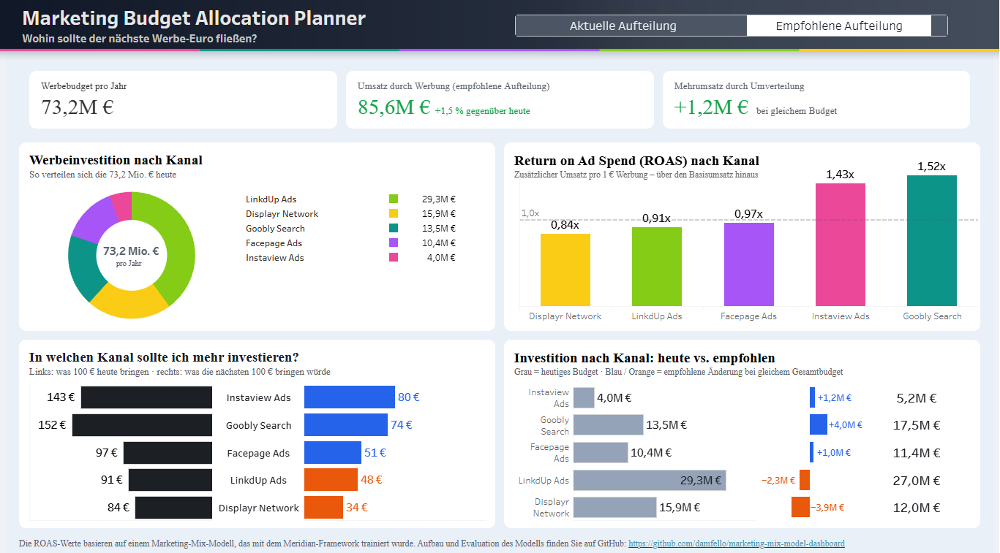

# Marketing Budget Allocation Planner

A Bayesian Marketing Mix Model (MMM) built with [Meridian](https://github.com/google/meridian) that answers one question: **where should the next marketing euro go?** Its results power an interactive Tableau dashboard.

**[View the live dashboard on Tableau Public](https://public.tableau.com/app/profile/duvan.fruto/viz/MMM-DashbaordFinal/BudgetAllocationPlanner?publish=yes)**



---

## Key findings

Based on a fictional brand with five paid channels and a €73.2M annual advertising budget (simulated data, 2021–2024).

| Channel | ROAS | Return of the next €100 | Recommended change |
|---|---|---|---|
| Goobly Search | 1.52x | €74 | +30% |
| Instaview Ads | 1.43x | €80 | +30% |
| Facepage Ads | 0.97x | €51 | +9% |
| LinkdUp Ads | 0.91x | €48 | −8% |
| Displayr Network | 0.84x | €34 | −25% |

- Advertising generates about **€84.4M** in incremental revenue per year (≈19% of total revenue).
- **Reallocating the same budget adds about +€1.2M per year (+1.5%).**
- Every channel returns less on the next euro than its average (diminishing returns), so the case is for reallocation, not for a bigger budget.
- Goobly and Instaview are the top two channels in all five model specifications tested.

ROAS here is *incremental*: it only counts revenue that would not have happened without the channel, after accounting for baseline demand, seasonality, competitor activity, promotions and organic media. It measures revenue, not profit.

---

## Repository structure

```
marketing-mix-model-dashboard/
├── dashboard/
│   ├── Budget_Allocation_Planner.twbx     Tableau workbook (data included)
│   └── assets/                            Header image
├── data/
│   └── geo_all_channels.csv               Meridian's simulated geo-level dataset
├── docs/
│   ├── tableau_data_dictionary.md         Column reference for the Tableau exports
│   └── images/                            README images
├── notebooks/
│   └── 03_meridian_mmm_v2.ipynb           Model training, validation and exports
├── outputs/
│   ├── tableau/                           CSV files that feed the dashboard
│   └── reports/                           Meridian HTML reports (download to view)
├── src/marketing_mix_model_dashboard/
│   └── config.py                          Paths, model and optimizer settings
├── pyproject.toml
└── uv.lock
```

---

## Methodology

**Data.** 40 geos × 156 weeks of impressions, spend, conversions and revenue per conversion for five paid channels, plus two controls (competitor sales, sentiment), a promotion variable and one organic channel.

**Model.** Geo-level Bayesian MMM in Meridian 2.0:

- Adstock (carryover up to 8 weeks) and Hill saturation (diminishing returns) per channel.
- ROI priors, controls, promotion as a non-media treatment and organic media.
- Time-varying baseline with 13 knots. Finer baselines (26 and 66 knots) did not converge and gave no accuracy gain.
- 10% of geo-weeks held out for out-of-sample validation.

**Validation.**

| Check | Result |
|---|---|
| Convergence | Max R-hat 1.03, ROI effective sample size 528 |
| Out-of-sample fit (geo level) | R² 0.75, wMAPE 0.21, train–holdout gap 0.9 pp |
| National in-sample error | wMAPE 3.9% |
| Meridian model review | All 8 checks passed, health score 94 |
| Sensitivity | ROAS refit under 4 alternative specifications |

**Optimization.** Meridian's budget optimizer reallocates the historical budget with each channel limited to ±30% of its current spend. It also produces scenarios from 80% to 120% of the budget.

---

## How to run

Requires [uv](https://docs.astral.sh/uv/) and Python 3.12.

```bash
git clone https://github.com/damfello/marketing-mix-model-dashboard.git
cd marketing-mix-model-dashboard
uv sync
```

Then open `notebooks/03_meridian_mmm_v2.ipynb` with the project's `.venv` kernel and run all cells.

Settings live in `src/marketing_mix_model_dashboard/config.py`:

| Setting | Purpose |
|---|---|
| `SAMPLING_PRESET` | `smoke` (code test), `standard` or `full` (final results) |
| `RUN_SENSITIVITY` | Refit the alternative model specifications |
| `LOAD_SAVED_MODEL` | Reuse a saved model and skip sampling |
| `SENSITIVITY_VARIANTS` | Alternative specs to compare |

A `full` run takes about 1.5–2 hours on a CPU. The fitted model is saved to `outputs/models/` (not tracked by Git).

---

## Limitations and next steps

- **No experimental calibration.** ROI priors are generic. Geo-lift tests on low-confidence channels would be the strongest improvement.
- **Revenue, not profit.** Profitability depends on product margins, which the dataset does not include.
- **Simulated data.** Results illustrate the method rather than a real business.
- **Productionization.** Move the notebook logic into modules (`data.py`, `model.py`, `optimize.py`, `export.py`) inside the existing package, add tests and schedule retraining.

---

## Tech stack

Python · Meridian · ArviZ · pandas · Matplotlib · uv · Tableau
